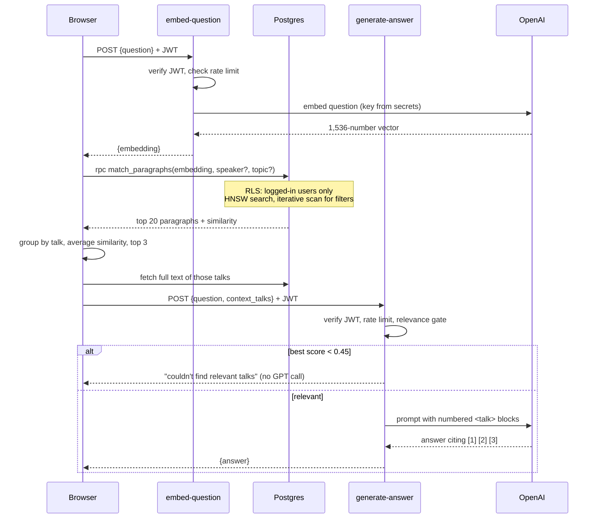

# Architecture

A RAG (Retrieval Augmented Generation) app over General Conference talks (2020–2025):
426 talks, 11,868 paragraphs. Static frontend, Supabase backend.

```
Browser (GitHub Pages)  ──►  Supabase Auth (magic link → JWT)
        │
        ├──► Edge Function  embed-question   ──► OpenAI embeddings   (key stays server-side)
        ├──► Postgres (pgvector)  match_paragraphs() / tables        (RLS decides what you see)
        └──► Edge Function  generate-answer  ──► OpenAI GPT-4o       (key stays server-side)
```

## 1. Components

| Layer | Where | Job |
|---|---|---|
| Frontend | `index.html`, `app.js`, `styles.css` | Login, three search modes, speaker + topic filters. Static files on GitHub Pages. |
| Auth | Supabase Auth | Magic-link login. Issues the JWT the browser sends on every call. |
| Database | Supabase Postgres + pgvector | Stores paragraphs, embeddings, topic tags. Enforces access with RLS. |
| `embed-question` | `supabase/functions/embed-question` | Auth + rate limit → question → embedding vector (OpenAI). |
| `generate-answer` | `supabase/functions/generate-answer` | Auth + rate limit → numbered talks in a prompt → GPT-4o answer with citations. |
| Shared code | `supabase/functions/_shared/` | `auth.ts` (JWT check), `cors.ts`, `ratelimit.ts`. |
| Schema | `supabase/migrations/` | Every database change, versioned. |
| Pipeline | `scripts/` | One-time data loading (below). |

## 2. Data pipeline (run once, offline)

```
churchofjesuschrist.org
        │  02_scrape_data.py        keeps <p> boundaries
        ▼
 talks.json  (426 talks, each with a paragraphs[] list)
        │  03_import_data.py        paragraphs ≥ 40 chars, new talk_id per talk
        ▼
 paragraphs.json ───────────────►  Postgres paragraph_embeddings (text only)  → keyword search works
        │  04_embed_data.py         OpenAI text-embedding-3-small, batches of 100 (~$0.02)
        ▼
 paragraphs_with_embeddings.json    (saved to disk so a DB error never re-costs money)
        │  05_update_embeddings.py  truncate + insert   (timed out on HNSW at batch ~87)
        │  05b_resume_embeddings.py inserts only the missing rows, batches of 20, retries
        ▼
 Postgres paragraph_embeddings (+ vectors)                                   → semantic + RAG work
        │  06_assign_topics.py      talk vector vs 18 topic descriptions, z-scored
        ▼
 Postgres talk_topics (783 tags)
```

## 3. Database

```
paragraph_embeddings                                talk_topics
  id, talk_id, title, speaker, calling,               talk_id, topic, score
  year, season, url, paragraph_num, text,             PK (talk_id, topic)
  embedding vector(1536),
  speaker_name  (generated: "By Elder X" → "X")    page_views         api_rate_limits
                                                      id, visited_at,    user_id, fn,
Indexes on paragraph_embeddings                       page_url,          window_start, hits
  HNSW (cosine)   semantic search                     user_agent
  GIN trigram     keyword ILIKE
  (talk_id, paragraph_num)   rebuild a full talk
  speaker_name    speaker filter

Functions
  match_paragraphs(query_embedding, match_count, filter_speaker, filter_topic)
  list_speakers()     list_topics()          rate_limit_hit(user, fn, limit, window)
```

## 4. Request flows

### Semantic search / RAG (the main flow)



### Keyword search
Browser → `paragraph_embeddings` `ILIKE '%term%'` (trigram index), optionally filtered by `speaker_name`
and by the topic's `talk_id`s. No OpenAI call.

### Login
Email → Supabase sends a magic link → click → browser receives a JWT → every later call carries it.

## 5. Security layers

| Asset | Protected by |
|---|---|
| Content tables | RLS: `SELECT` for `authenticated` only; no write policies; table privileges revoked for `anon`; only `service_role` writes |
| `page_views` | Intentionally public (read + insert) to contrast with the protected table; capped by length checks and a 30-day purge |
| OpenAI key | Lives only in Supabase secrets; used only inside Edge Functions |
| Service-role key | Only in git-ignored `config.secret.json`; bypasses RLS, so never in the browser |
| Anon key | Safe in `config.public.json` — RLS limits what it can do |
| Edge Functions | Deployed `--no-verify-jwt`; `auth.ts` verifies the token itself, then `ratelimit.ts` caps use per user |
| Cost | Input size caps, rate limits (120 embeds/hr, 30 answers/hr per user), relevance gate before GPT-4o |

Why two kinds of protection: Supabase protects the **database** (RLS). It cannot protect a
**third-party key** like OpenAI's, so the Edge Functions are the secure middle layer we build.

## 6. Features beyond the course template

- Paragraph-level chunking instead of sentences.
- Schema as migrations, with HNSW + trigram indexes.
- Speaker filter (normalized `speaker_name`) and topic filter (embedding-based tagging) across all three modes.
- Per-user rate limiting, least-privilege grants, `pg_cron` retention.
- Relevance gate and citation-numbered prompts in `generate-answer`.

See `SCALING.md` for measured sizes and what breaks first.

## 7. File map

```
index.html, app.js, styles.css     frontend
config.public.json                 Supabase URL + anon key (committed)
config.secret.json                 keys (git-ignored)
scripts/02..06, 05b                data pipeline
supabase/migrations/               7 migrations, in order:
   20261021000000  base schema (tables, RLS, indexes, match_sentences)
   20261021010000  switch to paragraph_embeddings + match_paragraphs
   20261022000000  speaker_name, list_speakers, filter_speaker
   20261022010000  normalize non-breaking spaces in speaker_name
   20261022020000  talk_topics, list_topics, filter_topic
   20261022030000  least-privilege grants + rate limiting
   20261022040000  pg_cron retention jobs
supabase/functions/                embed-question, generate-answer, _shared/
SCALING.md, ARCHITECTURE.md        notes
```
